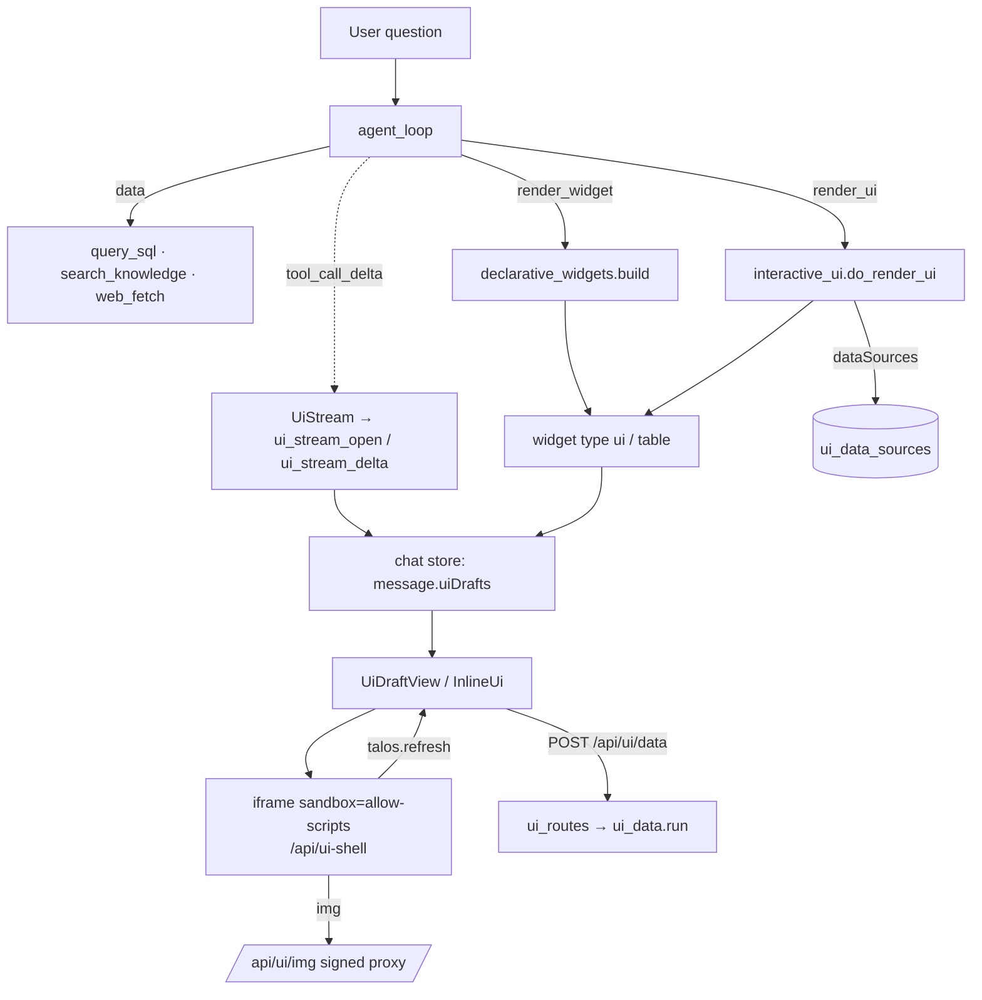

# Interactive answers

Talos can answer with something to look at and work with — a chart, key
figures, a flow diagram, a calculator, a map — rendered **inline in the chat**,
next to the text that introduces it. The preview panel stays reserved for files
and documents.

The feature is switched on per deployment in **Settings → Agent → Interactive
answers in the chat** (`interactive_answers_enabled`, off by default).

## Two tools, both generic

| Tool | The model sends | Talos builds | Use for |
|------|-----------------|--------------|---------|
| `render_widget` | data only (`type` + `data`) | the view, from its own templates | standard visuals: `chart`, `kpi`, `table`, `diagram` (Mermaid), `timeline`, `comparison` |
| `render_ui` | `css` / `html` / `js` / `data` | a sandboxed page around it | bespoke interactive UIs: calculators, simulations, adjustable comparisons, maps |

Neither tool knows a use case. What to build is steered by the prompt and by
the built-in **system skills** (`system_skills/`): `interactive-answers`
(base), `ui-visualization`, `ui-diagrams`, `ui-data`, `ui-maps`. They are
always available while the tools are, are not part of the user's skill
library (hidden in Settings → Skills, names reserved), and any number of them
can be loaded in one turn with `read_skill` (`src/system_skills.py`).

`sources` is required on both tools; Talos shows them under the view (kinds
`user`, `sql`, `knowledge`, `web`, `model`, `calculated`, `illustrative`) —
drawn by the host, never by the generated page.

## Flow



1. **Streaming.** While the model writes a `render_ui` call, `src/interactive_ui.UiStream`
   reads the growing JSON (native tool-call deltas or a ```` ```render_ui ```` fence)
   and emits `ui_stream_open` / `ui_stream_delta` events. The chat shows the card
   at its place in the stream: the model's placeholder lines, then a live preview of
   the markup (styles, no script). `tool_call_delta` is routed by tool name — only
   `create_document` / `update_document` open the editor panel.
2. **Final render.** The tool result carries a `ui` widget. `UiDraftView` mounts the
   finished `InlineUi` underneath the preview and swaps when it reports ready.
3. **Persistence.** The widget is stored in `metadata.tool_events`; later turns get
   only a short summary (title, sources, data shape, controls), never the markup.
   Control state (slider values, switches) survives rebuilds (turn settling, full
   screen) for the page session.

## The frame

`InlineUi` writes one self-contained document into a shell served by
`/api/ui-shell`, inside `<iframe sandbox="allow-scripts">` (opaque origin: no
cookies, no app storage, no app DOM).

The document contains, in order: the theme tokens (`--talos-*`, read from the live
app, palette from the dashboard scaffold), the embedded DM Sans font, the UI kit
(`web/src/lib/ui-kit.css` / `ui-kit.js`: `t-*` components, `talos.chart`,
`talos.map`, `talos.fmt`, `talos.color`), the bridge, the model's code, and any
libraries it uses. Libraries (ECharts, D3, Chart.js, three.js, Leaflet, Mermaid)
are served from `static/ui-vendor/` (`scripts/vendor_ui_libs.py`, pinned and
integrity-checked) and **embedded** by the host as JSON, started via `blob:` — so
the frame needs no network for code, and a downloaded copy works on its own.

Theme switches are posted into the live frame; height follows the content
(50–4000 px); frames mount lazily when they come near the viewport.

## Bridge

| From the frame | What happens |
|----------------|--------------|
| `talos.sendPrompt(text)` | sent to the chat as the user's message — only after a click in the frame, checked by the host (`navigator.userActivation`), one per click |
| `talos.openLink(url)` / `<a href>` | opened in a new tab — click required, https only, not the app's origin, and only URLs written literally in the answer |
| `talos.refresh(id, params)` | `POST /api/ui/data` by the host under the user's session (see below) |
| `talos.img(url)` | the signed proxy URL for a web image named in the answer |
| `talos.copy(text)` | copied to the clipboard by the host — click required |
| `talos.download(name, text)` | saved as a file by the host — click required; text formats only (csv, json, md, txt, ics, tsv, svg) |
| `talos.store.get/set/remove/clear` | JSON state per view (~100 KB), kept by the host in `localStorage` so a todo list or counter survives a reload |

## Built-in views

The tools that come with a picture — `get_weather`, `get_news`, `query_sql`
(and `render_widget` tables) — still send plain data widgets (`weather`,
`news`, `table` in `src/widgets.py`). The frontend renders them as interactive
UI too: `web/src/lib/builtinViews.ts` turns the data into a UI payload with a
static view script from `web/src/lib/views/`, and `InlineUi` shows it in the
same frame, kit and card as any `render_ui` answer. Because the conversion
happens at render time, stored conversations need no migration. These views
do not depend on the *interactive answers* setting — it only governs whether
the model may build views of its own. News thumbnails travel as signed
`/api/ui/img` URLs (`images` in the news widget), since the frame has no
cookies.

## Live data

`render_ui` may declare `dataSources` (`src/ui_data.py`): `sql` (read-only
statement with `:name` bind parameters), `web` (https URL template, host fixed),
`knowledge` (search template). Every parameter is typed and bounded (`int` /
`number` with min/max, `enum`, `string` with max length, `bool`, `date`).

The spec is validated at render time and stored in `ui_data_sources`, bound to the
user. `POST /api/ui/data` (`routes/ui_routes.py`) re-runs **only the stored spec**
with the resolved parameters — parameters reach SQL as bind values — after the
same permission checks the agent's tools face (`query_sql`, `web_fetch`,
`search_knowledge`), with a per-UI rate limit. Someone else's UI is reported as
unknown.

## Security model

| Concern | Measure |
|---------|---------|
| Generated code touching the app | iframe without `allow-same-origin`; messages accepted only from the frame's window and of known types |
| Network from the frame | CSP `connect-src 'none'`; scripts/styles only inline, `blob:` and this instance; images only this instance and the configured tile host |
| Data leaving via navigation | `render_ui` rejects code that navigates (`location`, `window.open`, meta refresh, `navigation.navigate`); links only to literal URLs on click |
| Prompts sent "as the user" | host-side user-activation check, one per gesture |
| Data sources | stored spec only, typed parameters, owner-bound, tool permissions, rate limit |
| Web images | rewritten at render time to `/api/ui/img?u=…&s=…` (HMAC from a key derived from the app key); the proxy serves signed URLs only, with the SSRF guard, image-type and size checks shared with the news thumbnails (`src/image_proxy.py`) |
| Maps | Browsers never contact the tile server: tiles come from `/api/ui/tiles/{z}/{x}/{y}.png`, a caching proxy (`src/tile_proxy.py`) that follows OpenStreetMap's tile usage policy — identifying User-Agent (with `ui_map_contact`), the instance's origin as `Referer`, disk cache honouring the server's caching headers (7 days when absent) with conditional revalidation, valid coordinates only, rate-limited, Leaflet look-ahead of one ring. Attribution and a "report a map issue" link in the frame and under it |

## Settings

| Key | Default | Meaning |
|-----|---------|---------|
| `interactive_answers_enabled` | `false` | enables `render_ui` and `render_widget` (never in subagents) |
| `ui_maps_enabled` | `true` | maps in interactive answers |
| `ui_map_tile_url` | `https://tile.openstreetmap.org/{z}/{x}/{y}.png` | tile server (https, `{z}/{x}/{y}`); use your own for heavy use |
| `ui_map_attribution` | (OSM) | attribution required by the tile server |
| `ui_map_max_zoom` | `19` | capped at 19 for OSM |
| `ui_map_contact` | `""` | e-mail or URL sent in the tile requests' User-Agent |
| `ui_map_cache_mb` | `1024` | size of the shared tile cache (`data/tile_cache/`) |

## Evaluating a model

Before enabling the feature for a model, run the eval set against it:

```bash
python scripts/ui_eval.py --eval scripts/ui_eval.example.jsonl   --base-url http://localhost:7000 --endpoint <endpoint-id> --model <model>   --cookie "talos_session=…" --save ui_eval.json
```

It runs every prompt in a fresh chat through the real chat endpoint and scores
whether the agent chose the right form (text, widget, interactive UI, file),
whether the view was built (retries after a rejected call are reported), and
whether the expected sources are cited without illustrative values standing in
for real data.

The set does not depend on a particular database or document collection:
prompts that need the instance's own data start with an unscored `setup` turn
in which the agent finds something fitting ("which table has a date and a
figure?"), and the scored question refers back to it. If the instance has no
data of the expected kind, the prompt is reported `n/a` and left out of the
rates. Concrete prompts for your own data can be added as further lines. Script
errors inside the frames are not visible to the script — open the eval chats
and check the error badge on the cards.

## Code map

| Path | Role |
|------|------|
| `src/interactive_ui.py` | `render_ui`: validation, summary, streaming parser, image signing, shell CSP, map config |
| `src/declarative_widgets.py` | `render_widget`: data → kit view |
| `src/ui_data.py` | data source specs, parameter checks, execution |
| `src/image_proxy.py` | shared public-image fetcher (SSRF guard) |
| `src/tile_proxy.py` | map tile proxy and cache |
| `src/system_skills.py`, `system_skills/` | built-in method skills |
| `routes/ui_routes.py` | `POST /api/ui/data`, `GET /api/ui/img`, `GET /api/ui/tiles/{z}/{x}/{y}.png` |
| `routes/document_routes.py` | `GET /api/ui-shell`, `GET /api/ui/config` |
| `web/src/lib/uiFrame.ts` | document builder, theme, libraries, CSP, bridge bootstrap |
| `web/src/lib/ui-kit.css`, `ui-kit.js` | the Talos UI kit inside the frame |
| `web/src/components/interactive/InlineUi.tsx` | the card, frame host, bridge handling, toolbar, source bar |
| `web/src/components/interactive/UiDraftView.tsx` | streaming draft → final hand-over |
| `web/src/lib/builtinViews.ts`, `web/src/lib/views/` | weather, news and table widgets as interactive UI |
| `scripts/ui_preview.py` | mock server with streamed and stored examples |
| `scripts/ui_eval.py`, `scripts/ui_eval.example.jsonl` | eval of a model against 30 prompts |
