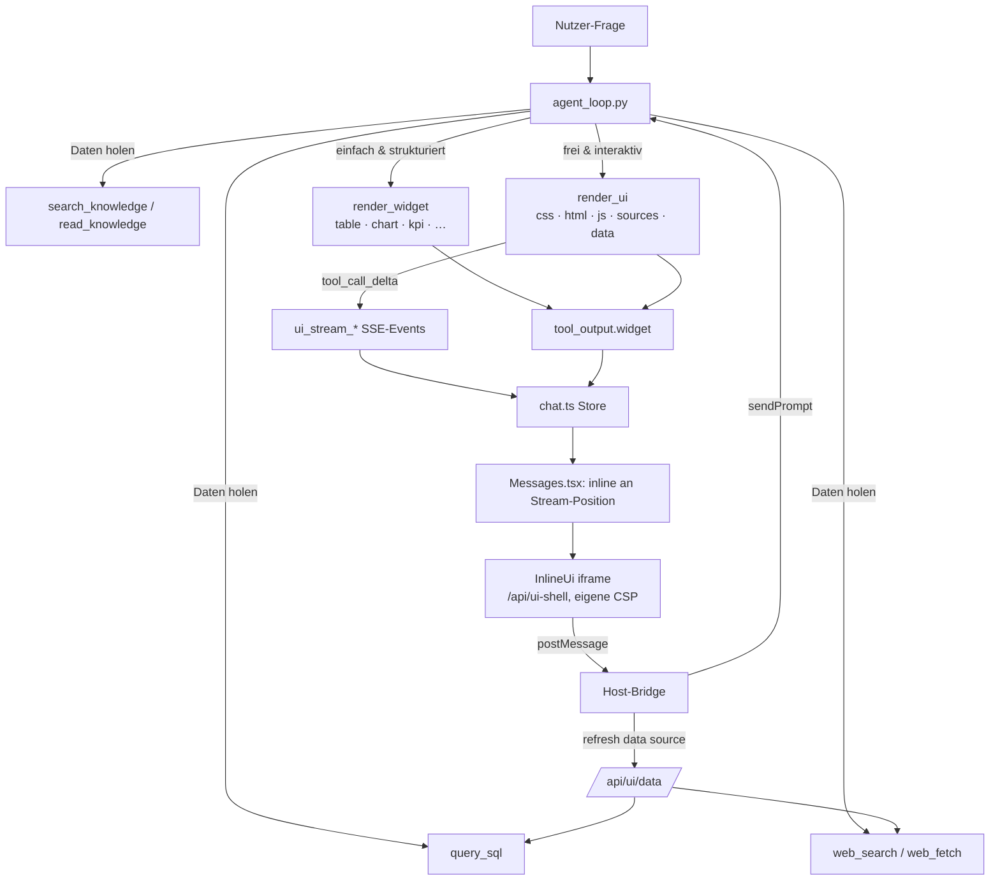

# Plan: Interaktive Antworten im Chat (Generative UI für Talos)

Status: Entwurf · Vorbild: [CopilotKit/OpenIntelligentUI](https://github.com/CopilotKit/OpenIntelligentUI) (im Folgenden „OIU“)

## 1. Ziel

Talos antwortet nicht nur mit Text, sondern – wenn es der Aufgabe hilft – mit
**interaktiven Antworten direkt im Chatverlauf**: Diagramme, Vergleiche mit
verstellbaren Gewichten, Rechner, Simulationen, Prozess-/Architekturdiagramme,
Karten, KPI-Übersichten, Zeitleisten usw.

Leitplanken (vom Auftrag vorgegeben):

1. **Alles rendert inline im Chat**, nicht im Preview-Panel/Sidebar. Das
   Preview-Panel bleibt für Dateien und Dokumente zuständig.
2. **Keine fest einprogrammierten Anwendungsfälle.** Code liefert Primitive
   (ein generisches UI-Tool, generische Widgets, eine Daten-Bridge), das
   „Was und Wie“ steuern Modell + Skills. Neue Muster = neuer Skill, kein Deployment.
3. **Echte Daten** aus Datenbank (`query_sql`), Wissen (RAG: `search_knowledge`,
   `read_knowledge`, `grep_knowledge`) und Web (`web_search`, `web_fetch`) –
   mit sichtbarer Herkunft.
4. **Skills werden dafür angelegt bzw. angepasst**, wo nötig.

Nicht-Ziele (vorerst): kollaboratives Editieren einer UI über mehrere Turns
(Patch-API), schreibende Aktionen aus der UI heraus, Persistenz von
UI-Zustand (Slider-Stellungen) über Reloads.

## 2. Was wir von OIU übernehmen – und was nicht

| OIU-Baustein | Übernehmen? | Talos-Umsetzung |
|---|---|---|
| `generateSandboxedUi` mit fester Feldreihenfolge `initialHeight → placeholderMessages → css → html → jsFunctions → jsExpressions` | **Ja** | Neues Tool `render_ui`, gleiche Reihenfolge (ermöglicht CSS-first-Streaming) |
| Streaming-Renderer: Platzhalter bis CSS fertig → Vorschau-iframe mit progressivem HTML (Idiomorph) → finales iframe, dann JS | **Ja** | Neue Komponente `InlineUi` (Port von `renderer.tsx`, `process-partial-html.ts`, `frame-content.ts`) |
| Websandbox (JetBrains) als iframe-Bridge | **Nein** | Talos hat schon ein Shell-iframe + `postMessage`-Protokoll (`/api/html-preview-shell`, `HtmlPreview.tsx`). Wird erweitert statt neue Abhängigkeit |
| Host-Bridge `sendPrompt` / `openLink`, validiert, nur nach Klick | **Ja** | `talos:ui-send-prompt`, `talos:ui-open-link` |
| Auto-Height via ResizeObserver + geclampter Höhe | **Ja** | 1:1 portiert (MIN 50 / MAX 4000 px) |
| Design-System (Theme-Variablen, SVG-Klassen, Formular-Styles) ins iframe injiziert | **Ja** | Talos-Tokens aus `branding/*/brand.json` + Light/Dark |
| Importmap mit `three`, `d3`, `chart.js`, `gsap` von esm.sh | **Teilweise** | Talos läuft on-prem/offline (Mermaid ist z. B. schon vendored) → Bibliotheken **lokal ausliefern** |
| Jev: externer Klassifizierer mit 13 festen Kategorien + Tool-Filter + hartkodierte Prompt-Zusätze (Karten, Trips) | **Nein** | Darstellungsentscheidung trifft das Modell, gesteuert durch Prompt-Abschnitt + Skills. Kein externer Dienst, keine Enum |
| A2UI-Tabellen-Katalog | **Konzept ja** | Talos hat das Widget-System (`src/widgets.py`) bereits → um generische deklarative Widgets erweitern |
| `query_data` (Beispiel-CSV) | **Nein** | Talos hat echte Quellen (SQL, RAG, Web) |
| `get_trip_stop_images`, `createTripAnimator`, USGS-Tiles | **Nein (hartkodiert)** | Allgemeiner Bild-Proxy + konfigurierbarer Kachelserver; Animationsmuster gehören in Skills |
| Templates (Seed-HTML im Agent-State) | **Später/optional** | Skills mit `references/`-Beispielen decken das ab |
| Export der UI als Standalone-HTML (Websandbox-Stub) | **Ja** | Download HTML/PNG, „als Datei speichern“ |
| Provenienz-Regeln im Prompt (Nutzerdaten vs. abgerufen vs. berechnet vs. illustrativ) | **Ja, verschärft** | Pflichtfeld `sources` im Tool, vom **Host** außerhalb des iframes angezeigt |

## 3. Architektur-Überblick



Kernideen:

- **Zwei Wege, beide generisch.** `render_widget` für Standardfälle (billig,
  einheitlich, auch für kleine lokale Modelle zuverlässig), `render_ui` für alles
  Freie. Keiner der beiden kennt Anwendungsfälle.
- **Daten werden vom Agenten geholt, nicht vom iframe.** Das iframe hat kein
  Netzwerk (`connect-src 'none'`). Es bekommt die Daten eingebettet und kann
  höchstens **beim Host** eine vom Agenten registrierte Datenquelle neu laden.
- **Herkunft zeigt der Host an**, nicht das generierte HTML – sonst könnte das
  Modell Quellen „hineinmalen“.

## 4. Änderungen im Detail

### Phase 0 – Grundlagen & Entscheidungen

- **Feature-Flag** `interactive_answers` in den Einstellungen
  (`src/settings.py`, Admin-UI in `SettingsDialog.tsx`), zusätzlich pro Modell
  abschaltbar (kleine lokale Modelle erzeugen fehlerhaftes JS häufiger).
- **Bibliotheken lokal ausliefern** unter `/static/ui-vendor/` (versioniert, mit
  Lizenzen): ECharts (Runtime liegt schon in `sandbox/vendor/echarts-runtime.js`),
  D3, Chart.js, Three.js, GSAP, Leaflet, Mermaid (ist schon in `docs/javascripts/`).
  Eine Importmap zeigt auf diese Pfade. CDN nur optional per Setting.
- **Größenlimits** festlegen: `render_ui` gesamt z. B. 256 KB (statt 64 KB des
  Widget-Kanals), eingebettete Daten z. B. 512 KB, sonst Datenquelle verwenden.

### Phase 1 – Backend: Tool `render_ui`

| Datei | Änderung |
|---|---|
| `src/tool_schemas.py` | Neues Schema `render_ui`: `title`, `initialHeight`, `placeholderMessages[]`, `css`, `html`, `js` (Funktionen), `jsInit[]` (kleine Aufrufe), `data` (JSON, optional), `sources[]` (Pflicht: `{kind: user\|sql\|knowledge\|web\|calculated\|illustrative, label, ref?}`), `dataSources[]` (optional, s. Phase 3). Beschreibung betont die Feldreihenfolge. |
| `src/agent_tools.py`, `src/tool_parsing.py` | Fence-Variante ` ```render_ui ` mit JSON-Body für Modelle ohne native Tool-Calls (Talos unterstützt beides, siehe `_resolve_tool_blocks` in `agent_loop.py`). |
| `src/agent_loop.py` (`TOOL_SECTIONS`) | Kurzer Prompt-Abschnitt: wann Text / Widget / UI; Feldreihenfolge; Sandbox-Regeln (kein Netzwerk, kein Storage, keine Top-Level-`await`); Provenienz; „UI generiert“ heißt fertig, nicht neu bauen. Details in Skills (Phase 6). Bestehender Hinweis „interaktive HTML via `create_document`“ (bash/python-Abschnitt) wird umgestellt auf `render_ui`. |
| `src/tool_index.py` | `render_ui` und `render_widget` in `ALWAYS_AVAILABLE` (gleiche Begründung wie bei `web_search`: ob eine Visualisierung hilft, entscheidet sich oft erst mitten im Turn). Embedding-Beschreibung ergänzen. |
| `src/tool_implementations.py` | Handler `do_render_ui`: validiert Felder, Größen, `sources`; normalisiert; registriert `dataSources` (Phase 3); gibt kurze Model-Ausgabe zurück („UI gerendert: <title>, <n> Datenpunkte“) und als User-Kopie ein Widget `{type: "ui", version: 1, data: {...}}`. |
| `src/widgets.py` | Typ `ui` in `WIDGET_TYPES`; eigener Größen-Cap für `ui`; `sanitize_widget` unverändert als Grenze. |
| `src/tool_execution.py` | `render_ui`/`render_widget` als nicht-exec Tools registrieren, Security-Klasse „harmlos“ (`src/tool_security.py`). |
| `src/agent_loop.py` (Streaming) | Der bestehende `tool_call_delta`-Pfad (`_doc_acc`, `doc_stream_open/delta`) geht heute davon aus, dass jedes gestreamte Argument ein Dokument ist. **Umbauen auf namensbasiertes Routing**: bei `name == "render_ui"` einen inkrementellen JSON-Feldparser nutzen und `ui_stream_open` (title, initialHeight, placeholderMessages), `ui_stream_delta` (`{field, value, complete}`) senden. Dokument-Tools behalten ihr Verhalten. Gleiches für Fence-Variante (Text-Stream erkennen). |
| `routes/chat_routes.py` | `ui_stream_open`, `ui_stream_delta` in die Liste weitergeleiteter Event-Typen (Zeile ~1147). Resume (`/api/chat/resume`) funktioniert dann automatisch, weil das Event-Log repliziert wird. |
| Persistenz | `tool_event["widget"]` speichert die fertige UI bereits (Pfad existiert, `agent_loop.py` ~3918). Prüfen, dass `history_replay.py` und Kontext-Kompression das große Widget **nicht** in den Modellkontext zurückspielen (nur die Kurz-Ausgabe). |
| Kontext für Folge-Turns | Kompakte Zusammenfassung pro UI im Verlauf (Titel, Datenquellen, Steuerelemente), damit „mach das als Balkendiagramm“ funktioniert, ohne 30 KB HTML erneut zu senden. |

### Phase 2 – Frontend: Inline-Renderer

| Datei | Änderung |
|---|---|
| `routes/document_routes.py` | Neue Shell-Route `/api/ui-shell` (analog `/api/html-preview-shell`) mit eigener CSP: `default-src 'none'; script-src 'unsafe-inline' 'unsafe-eval' 'self'` (nur `/static/ui-vendor/`); `style-src 'unsafe-inline' 'self'`; `img-src data: blob: 'self'` (nur Bild-Proxy-Pfad); `font-src data: 'self'`; `connect-src 'none'`; `form-action 'none'`; `base-uri 'none'`. Middleware-Ausnahme in `core/middleware.py` wie für die Preview-Shell. Die Shell enthält: Theme-CSS, Importmap, Resize-Reporter, Bridge-Stub (`window.talos.sendPrompt/openLink/refresh`), Message-Handler für `init / css / html-preview / html-final / run`. |
| `web/src/components/interactive/InlineUi.tsx` (neu) | Port der OIU-Logik: Throttling (sofort bei CSS fertig, HTML fertig, neue JS-Teile), Platzhalter mit `placeholderMessages`, Vorschau mit `processPartialHtml` + Morph, dann finale Ausführung `js` → `jsInit[]` sequenziell, Fehleranzeige pro Init-Schritt. Höhe aus Resize-Nachrichten, geclampt. Theme-Wechsel per `talos:theme` (gibt es schon in `html-export-bridge.js`). Lazy-Mount (IntersectionObserver), damit lange Chats nicht dutzende iframes gleichzeitig laufen lassen. |
| `web/src/lib/uiFrame.ts` (neu) | `processPartialHtml`, `extractCompleteStyles`, Höhen-Clamp, Message-Typen, Validierung eingehender Nachrichten (nur `event.source === iframe.contentWindow`). |
| `web/src/components/widgets/registry.tsx` | Typ `ui` → `InlineUi` (für fertige/persistierte Turns). |
| `web/src/state/chat.ts` | `ui_stream_open` / `ui_stream_delta` → laufender Tool-Call bekommt `uiDraft`; bei `tool_output` wird daraus das fertige Widget. Wichtig: diese Events **nicht** über `useUi.openPreview` leiten (der `doc_stream_*`-Pfad öffnet heute das Panel). |
| `web/src/api/types.ts` | `ToolCall.uiDraft`, Event-Typen. |
| `web/src/components/Messages.tsx` | Heute stehen Widgets gesammelt **über** der Antwort. Für interaktive Antworten: **an der Stream-Position** rendern (Text → UI → Text), also Antwort-Inhalt und UI-Blöcke als geordnete Segmente. Nicht in die Activity-Fold einklappen (`staysInFold` bleibt nur für SQL-Ergebnistabellen). |
| `web/src/components/ToolGroup.tsx`, `ToolRow.tsx`, `lib/toolLabels.ts` | Tool-Zeile für `render_ui` minimal („Erstelle Visualisierung …“), keine JSON-Dumps. |
| Toolbar an der UI | Vollbild (Modal im Chat, **nicht** das Seitenpanel), Quelltext, HTML herunterladen (Standalone mit Bridge-Stub, Port von `assembleStandaloneHtmlFromActivity`), PNG (vorhandenes `requestHtmlPng`), „Als Datei speichern“ (legt Artefakt an). |
| i18n | `web/src/i18n/de.ts`, `en.ts`: Platzhalter, Fehler, Toolbar, Bestätigungen. |

### Phase 3 – Host-Bridge & Daten-Bridge

Bridge-Nachrichten (alle zod-artig validiert, nur nach Nutzerklick, nie on load/Timer):

| Nachricht | Verhalten |
|---|---|
| `sendPrompt({text})` | max. 4000 Zeichen; abgelehnt, wenn ein Turn läuft; ruft `useChat.send` im aktuellen Chat. UI zeigt Status/Fehler. |
| `openLink({url})` | nur `https:`, Prüfung mit `src/url_safety.py`-Regeln (Client-Port), öffnet mit `noopener`. |
| `refresh({sourceId, params})` | Lädt eine **vom Agenten registrierte** Datenquelle neu (s. u.). |
| `ask_user`-artig (später) | Formular-Ergebnisse als strukturierte Antwort zurück an den Agenten. |

**Datenquellen** (macht UIs „lebendig“, ohne dem iframe Rechte zu geben):

- Im `render_ui`-Aufruf kann der Agent `dataSources` deklarieren, z. B.
  `{id: "umsatz", kind: "sql", query: "SELECT … WHERE jahr = :jahr", params: {jahr: {type: "int", min: 2015, max: 2030}}}`
  oder `{id: "kurs", kind: "web", url: "https://…", extract: "json"}`.
- `do_render_ui` validiert die Abfrage wie `query_sql` (read-only, gleiche
  Verbindung, gleiche Rechte des Nutzers) und speichert sie serverseitig zur
  Nachricht (DB-Tabelle `ui_data_sources`: message_id, source_id, owner, spec).
- Neuer Endpoint `POST /api/ui/data` (`routes/ui_routes.py`, neu): nimmt
  `message_id`, `source_id`, `params`, prüft Besitz + Parametertypen/-grenzen,
  führt **nur die gespeicherte** Abfrage aus, Rate-Limit über `src/rate_limiter.py`,
  Zeilen-/Byte-Limit, Ergebnis als JSON an den Host, der es ins iframe postet.
- Das iframe sieht nie Session-Cookies, SQL-Zugangsdaten oder beliebige URLs.

### Phase 4 – Datenintegration (DB, Wissen, Web)

- **Datenbank:** Agent fragt per `query_sql` ab (aggregiert in SQL), bettet das
  Ergebnis in `data` ein oder registriert es als Datenquelle für Filter/Parameter.
  Großes Ergebnis → Datenquelle statt Einbettung.
- **Wissen (RAG):** Agent nutzt `search_knowledge`/`read_knowledge`, übergibt
  Kennzahlen/Tabellen aus Dokumenten (`src/rag_tables.py`) als `data`; `sources`
  verweist auf Dokument + Abschnitt. Host verlinkt die Quelle auf den
  bestehenden Dokument-Viewer (`RagSources.tsx`/`Citations.tsx` wiederverwenden).
- **Web:** `web_search`/`web_fetch` liefern Inhalte; `sources` mit URLs, Host
  zeigt sie wie Web-Zitate (`citations`-Event). Bilder aus dem Web nur über einen
  **Bild-Proxy** `/api/ui/img?u=…` (Muster: News-Thumbnail-Proxy, `tests/test_news_thumbnail_proxy.py`) mit `url_safety`, Größen- und MIME-Prüfung.
- **Provenienz-Leiste:** unter jeder UI vom Host gerendert: „Daten: SQL · Wissen
  (2 Dokumente) · Web (3 Seiten) · berechnet · illustrativ“. Fehlt `sources`,
  lehnt das Tool den Aufruf ab.
- **Leak-Schutz:** `src/web_leak_guard.py` / `src/ingest_redaction.py` gelten auch
  für Daten, die in eine UI eingebettet werden, die aus Web-Inhalten gebaut wird
  (kein Mischen interner Daten in nach außen gehende Web-Anfragen).

### Phase 5 – Generische deklarative Widgets (`render_widget`)

Für Fälle, in denen kein freies HTML nötig ist – schneller, robuster, auch mit
kleinen Modellen:

| Widget | Payload | Komponente |
|---|---|---|
| `table` | `columns`, `rows`, `title`, `source` (existiert für SQL; vom Modell direkt nutzbar machen) | `TableWidget.tsx` |
| `chart` | ECharts-`option` (Whitelist ohne Funktionen/HTML-Formatter) + `source` | `ChartView.tsx` erweitern |
| `kpi` | Liste `{label, value, unit, delta, trend}` | neu |
| `diagram` | Mermaid-Quelltext | neu (Mermaid lokal) |
| `timeline`, `comparison` | generische Listen-/Matrix-Struktur | neu, optional |

Ein Tool `render_widget(type, data)` → `make_widget` + `sanitize_widget`.
Bewusst **Primitive**, keine Fachfälle.

### Phase 6 – Skills

Neue/angepasste Skills unter `sample_skills/` (werden über
`seed_sample_skills` in `services/memory/shared_skills.py` ausgeliefert):

| Skill | Inhalt |
|---|---|
| `interactive-answers` (neu, Basis) | Entscheidungsregel Text / Widget / UI (verstehen · vergleichen · Werkzeug bauen); keine Zeremonie; mehrere Abschnitte erlaubt; Folge-Turns = neue UI, kein Patchen; Provenienz-Pflicht; Bridge-Regeln mit Beispiel (Button → `sendPrompt` mit gewählten Werten). Port von OIU `master-playbook`, ohne Jev. |
| `ui-visualization` (neu) | Diagrammwahl (Trend, Ranking, Verteilung, Anteil, Zusammenhang), lokale Bibliotheken und Importmap, responsive Layouts, Barrierefreiheit, Eingabevalidierung (keine NaN/Infinity), Reduced Motion, 3D nur wenn nötig. Port von OIU `advanced-visualization`, ohne USGS/Trip-Spezialfälle. |
| `ui-diagrams` (neu) | SVG-/Mermaid-Diagramme für Prozesse, Architekturen, Abläufe. Port von OIU `svg-diagrams`, an Talos-Tokens angepasst. |
| `ui-data` (neu) | Wie Daten aus `query_sql`, RAG und Web in eine UI kommen: aggregieren, einbetten vs. Datenquelle, Parameter-Grenzen, `sources` richtig füllen, nie Daten erfinden. |
| `ui-maps` (neu, optional) | Karten mit Leaflet und dem **konfigurierten** Kachelserver (on-prem/OSM), Marker, Attribution, Fehlerzustände. Ersetzt OIUs hartkodierte USGS-Logik. |
| `dashboard-v2` (anpassen) | Abgrenzung: Dashboard **als Datei/Export** (16:9, A4, PNG) bleibt hier; schnelle interaktive Auswertung **im Chat** → `render_ui`/`render_widget`. |
| `skill-creator` (anpassen) | Kennt `render_ui`, damit Nutzer eigene UI-Muster als Skill anlegen können (z. B. „Schichtplan-Rechner“, „Angebotsvergleich im Firmenlayout“). Das ist der Mechanismus für „nicht hartkodiert“. |

Zusätzlich: Die Skill-Auswahl (`get_relevant_skills`) sollte `interactive-answers`
bevorzugen, wenn `render_ui` im Toolset ist (sonst lernt das Modell die Regeln nie).

### Phase 7 – Design-System im iframe

- `web/src/lib/uiTheme.ts` (neu) erzeugt CSS-Variablen aus dem aktiven Branding
  (`core/branding.py`, `branding/*/brand.json`) für Light/Dark:
  `--color-text-primary`, `--color-background-*`, `--color-border-*`,
  `--font-sans`, Radien, Diagramm-Palette.
- SVG-Farbklassen (`.c-blue`, …) und Formular-Styles wie in OIU
  (`packages/design-system`), auf Talos-Palette gemappt.
- Schriften lokal (Encode Sans liegt schon in `sandbox/vendor/brand/`).

### Phase 8 – Sicherheit (Checkliste)

- iframe `sandbox="allow-scripts"` (ohne `allow-same-origin`), eigene Shell-Origin-Policy, CSP wie oben.
- Nur Nachrichten von `iframe.contentWindow` akzeptieren; Schema-Validierung; Rate-Limit pro UI.
- Keine schreibenden Aktionen aus der UI; `sendPrompt` nur nach Klick (im Skill und per Bridge: Aktivierung erfordert `event.isTrusted`-Klick im iframe → Bridge-Stub prüft User-Activation).
- Datenquellen: nur gespeicherte, read-only, Besitzer-gebunden, Parameter typisiert und begrenzt.
- Bild-Proxy: `url_safety`/`net_trust`, Größenlimit, nur Bild-MIME.
- Kein Einbetten von Secrets; `prompt_security`-Regeln gelten für generierten Code.
- Security-Review vor Aktivierung per Default.

### Phase 9 – Tests

- **Backend (pytest):** Schema/Validierung `render_ui`, inkrementeller
  Feldparser (unvollständiges JSON, Escapes, Unicode), Event-Weiterleitung,
  Persistenz + Replay ohne Kontext-Aufblähung, Datenquellen-Autorisierung
  (fremde Nachricht, falsche Parameter, Limit), Bild-Proxy.
- **Frontend:** `processPartialHtml`, Höhen-Clamp, Bridge-Validierung,
  Store-Reducer für `ui_stream_*`. (Aktuell kein Test-Runner im `web/`-Paket →
  Vitest ergänzen oder als Browser-Test.)
- **Browser (Playwright, Muster `tests/dashboard_browser.cjs`):** Streaming-Ablauf
  mit gemockten Events (`scripts/ui_preview.py` um `ui_stream_*` erweitern),
  Theme-Wechsel, Resize, `sendPrompt`, CSP blockiert Netzwerk.
- **Eval-Set:** ~30 Prompts (verstehen/vergleichen/Werkzeug, DB/RAG/Web,
  „nur Text“-Fälle) gegen die Zielmodelle; Kriterien: passende Darstellung,
  JS-Fehlerfrei, Herkunft korrekt, keine erfundenen Daten.

### Phase 10 – Doku & Rollout

- `docs/architecture/interactive-answers.md`, `docs/frontend/components.md`,
  `docs/backend/api.md` (neue Endpoints), `mkdocs.yml`-Navigation.
- Rollout: Flag aus → intern testen → pro Modell freischalten → Default an.

## 5. Reihenfolge & Meilensteine

| # | Meilenstein | Enthält | Größe |
|---|---|---|---|
| M1 | Inline-UI ohne Streaming | `render_ui` (Backend + Fence), Widget `ui`, `/api/ui-shell`, `InlineUi` (nur Final-Render), Basis-Skill, Flag | M |
| M2 | Streaming | Namensbasiertes `tool_call_delta`-Routing, `ui_stream_*`, Platzhalter/Vorschau/Morph, Position im Chat | M |
| M3 | Bridge & Daten | `sendPrompt`/`openLink`, Datenquellen + `/api/ui/data`, Provenienz-Leiste, Bild-Proxy | L |
| M4 | Generische Widgets | `render_widget` mit `table`/`chart`/`kpi`/`diagram` | M |
| M5 | Skills & Design | `ui-visualization`, `ui-diagrams`, `ui-data`, `ui-maps`, Theme aus Branding, lokale Bibliotheken, Anpassung `dashboard-v2`/`skill-creator` | M |
| M6 | Härtung | Security-Review, Tests, Eval, Doku, Rollout | M |

M1 liefert schon sichtbaren Nutzen; M2 macht es „gefühlt schnell“; M3 macht es
datengetrieben.

## 6. Offene Entscheidungen

1. **Welche Modelle** sollen `render_ui` bekommen? (Bestimmt, ob M4 vor M2 kommen sollte.)
2. **CDN erlaubt** oder strikt offline? (Plan geht von offline aus.)
3. **Kartenkacheln:** eigener Tile-Server, OSM, oder Karten vorerst weglassen?
4. **Datenquellen-Refresh:** reicht SQL + Web, oder auch RAG-Suchen aus der UI?
5. **„Als Datei speichern“:** soll eine Inline-UI zusätzlich als Artefakt in der Artefakt-Bibliothek landen?
6. **Altes Verhalten:** soll interaktives HTML über `create_document`/Preview-Panel abgeschaltet oder nur nicht mehr empfohlen werden?
